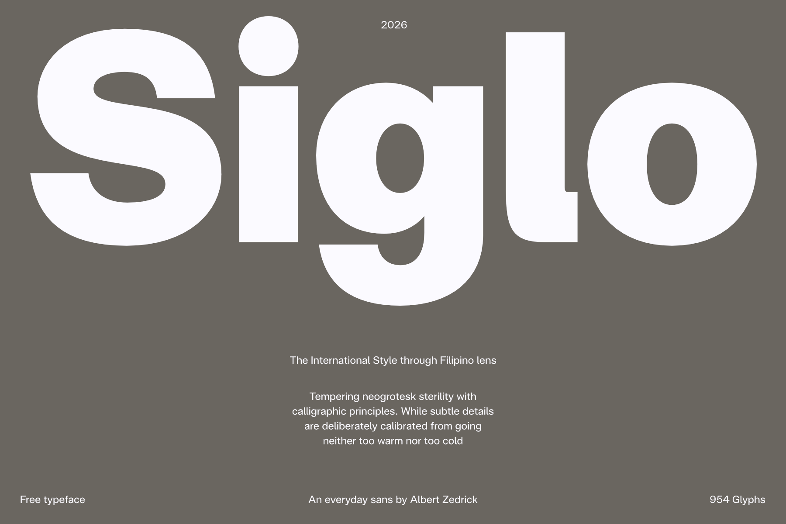
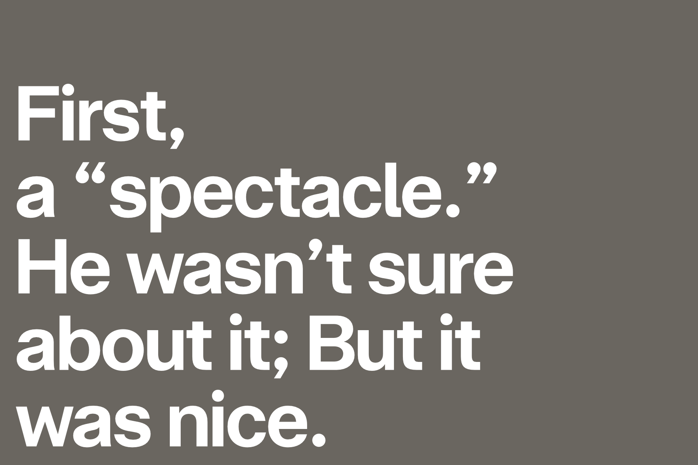
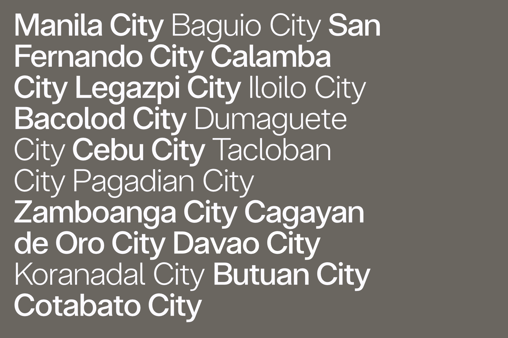
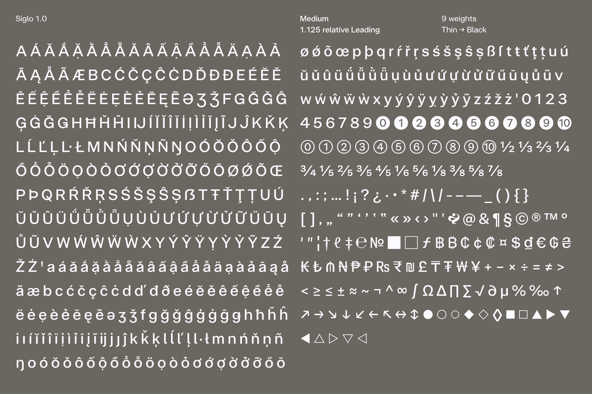

[Siglo: Neogrotesk tempered by calligraphic principles](https://www.albertzedrick.com/typefaces/siglo)
====

## About
Siglo is a contemporary sans serif brought from the long line of neogrotesks built for the 21st century. Sterile forms of the genre tamed by calligraphic principles. While suble details are deliberately callibrated from going neither too warm nor too cold. The International Style through the lens of a Filipino. A nod to the urban sprawl.

Siglo starts with 9 weights ranging from Thin to Black. This is aimed to be a workhorse companion for various design tasks. Character support covers EU West, EU Central, EU South East, South American, Oceanian, Esperanto, and Vietnamese. Current cut is designed for headlines but spaced for text sizes.

## Tests

[![][Fontspector]](https://albertzedrick.github.io/siglo.git/fontspector/fontspector-report.html)
[![][OpenType]](https://albertzedrick.github.io/siglo.git/fontspector/fontspector-report.html)
[![][Universal]](https://albertzedrick.github.io/siglo.git/fontspector/fontspector-report.html)
[![][Google Fonts]](https://albertzedrick.github.io/siglo.git/fontspector/fontspector-report.html)
[![][Glyphset]](https://albertzedrick.github.io/siglo.git/fontspector/fontspector-report.html)

[Fontspector]: https://img.shields.io/endpoint?url=https%3A%2F%2Falbertzedrick.github.io%2Fsiglo.git%2Fbadges%2FFontspectorQA.json
[OpenType]: https://img.shields.io/endpoint?url=https%3A%2F%2Falbertzedrick.github.io%2Fsiglo.git%2Fbadges%2FOpentypeSpecificationChecks.json
[Universal]: https://img.shields.io/endpoint?url=https%3A%2F%2Falbertzedrick.github.io%2Fsiglo.git%2Fbadges%2FUniversalProfileChecks.json
[Google Fonts]: https://img.shields.io/endpoint?url=https%3A%2F%2Falbertzedrick.github.io%2Fsiglo.git%2Fbadges%2FFontFileChecks.json
[Outline Correctness]: https://img.shields.io/endpoint?url=https%3A%2F%2Falbertzedrick.github.io%2Fsiglo.git%2Fbadges%2FOutlineCorrectnessChecks.json
[Glyphset]: https://img.shields.io/endpoint?url=https%3A%2F%2Falbertzedrick.github.io%2Fsiglo.git%2Fbadges%2FGlyphsetChecks.json

## Building

Fonts are built automatically by GitHub Actions — take a look in the "Actions" tab for the latest build.

If you want to build fonts manually on your own computer:

- `make build` will produce font files.
- `make test` will run [Fontspector](https://fonttools.github.io/fontspector/)'s quality assurance tests.
- `make proof` will generate HTML proof files.

## License

This Font Software is licensed under the SIL Open Font License, Version 1.1.
This license is available with a FAQ at https://openfontlicense.org

## Repository Layout

This font repository structure is inspired by [Unified Font Repository v0.3](https://github.com/unified-font-repository/Unified-Font-Repository), modified for the Google Fonts workflow.

## About the Author

Albert Zedrick Dela Cruz hails from Metro Manila Philippines. Taking curiosities in every corner, he strives to weave into the in-between of things in hopes of finding the necessary ingredients for his new typework.

## Contact
Questions? Send me an email at hello@albertzedrick.com
